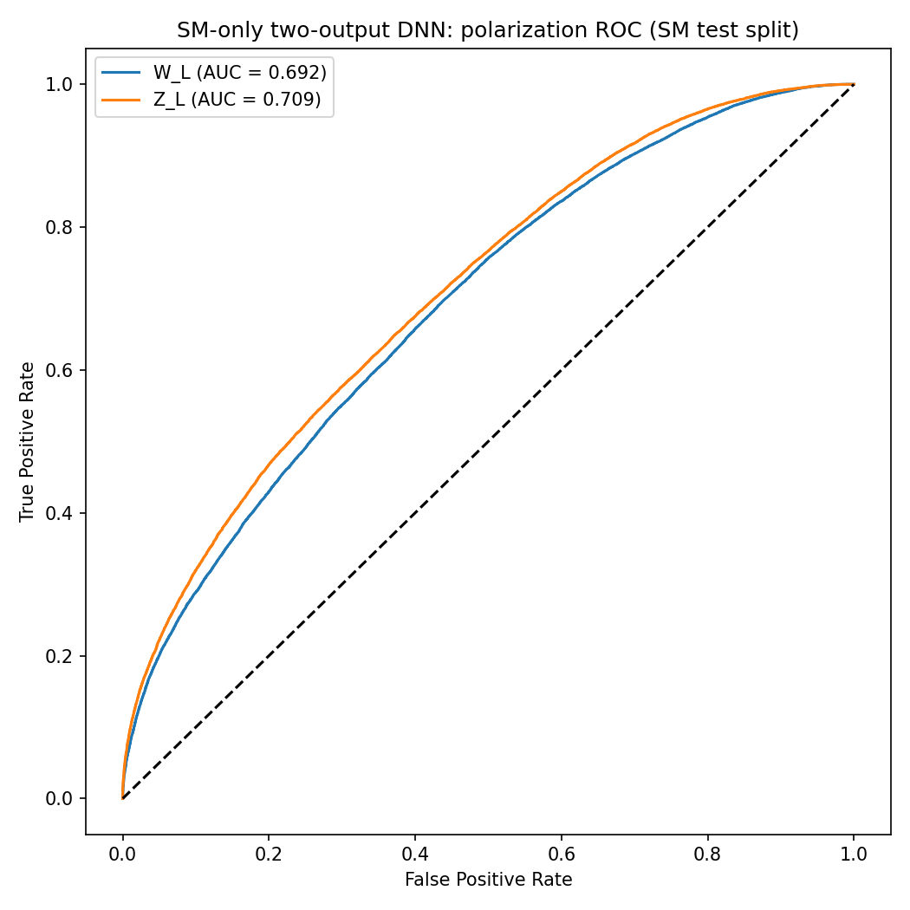
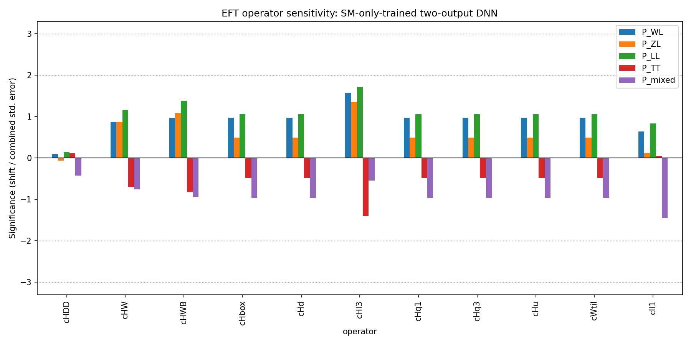

# Polarization Analysis: SM vs. EFT in WZ Production

[](https://github.com/mbayatma/Polarization_analysis/actions/workflows/tests.yml)

Analysis framework for studying **vector boson polarization** in WZ diboson
production, comparing Standard Model (SM) predictions against Effective
Field Theory (EFT) extensions across 12 dimension-6 SMEFT operators. Built
on Monte Carlo events (LHE-level and Pythia-showered), it covers the full
chain from ROOT files to physics plots to a neural-network approach that
asks which EFT operators leave a detectable imprint on event kinematics.

## Physics background

In the Standard Model, W and Z bosons produced in WZ diboson events can be
polarized longitudinally (L) or transversely (T). The fraction of
longitudinally-polarized bosons is sensitive to electroweak symmetry
breaking, and BSM physics parameterized as SMEFT operators (`cHWB`, `cHDD`,
`cHq3`, `cWtil`, ...) can shift these polarization fractions relative to the
SM prediction. This repository:

1. Reads generator-level and Pythia-showered ROOT files for each of the 4
   polarization states (`W_L Z_L`, `W_T Z_T`, `W_T Z_L`, `W_L Z_T`) under
   both the SM and each EFT operator hypothesis.
2. Computes kinematic observables (invariant masses, angular separations,
   rapidities, leading-lepton kinematics) normalized by absolute cross
   section, and plots SM vs. EFT comparisons with per-polarization ratio
   panels.
3. Exports the same observables to Parquet and trains neural networks to
   probe polarization and EFT sensitivity directly from kinematics (see
   [Machine learning](#machine-learning-which-eft-operators-are-detectable)
   below).

## Repository structure

```
plotter/            Physics variable computation and plotting (SM/EFT comparison histograms)
ml/                 Data loading/labeling, model architectures, training, evaluation
tests/              pytest unit tests for pure physics/ML utility functions
main.py             CLI: plot SM vs EFT comparisons for LHE-level (no shower) samples
export_ml.py        CLI: export the analysis dataframe to SM / EFT / combined Parquet files
xsections_all.csv   Per-operator, per-polarization cross sections (pb), read by plotter/config.py
```

## Installation

```bash
python3 -m venv .venv && source .venv/bin/activate
pip install -r requirements.txt        # plotting + data export
pip install -r requirements-ml.txt     # + TensorFlow/scikit-learn, only needed for ml/train_two_output.py
```

## Usage: SM vs. EFT plotting

```bash
python3 main.py --var M_ee_Z              # Plot one variable for the default operator
python3 main.py --all --operator cHWB     # Plot every variable for one EFT operator
python3 main.py --all                     # Plot every variable for every EFT operator
```

Plots are written per-operator to `polariztion_plots_new/<operator>/`, each
showing the SM and EFT distributions per polarization state plus an
EFT/SM ratio panel.

## Exporting datasets for ML

```bash
python3 export_ml.py --mode ALL --output_dir ml_datasets
```

Produces `polarization_SM.parquet`, `polarization_EFT.parquet`, and
`polarization_full.parquet` (only written when the run actually covers both
theories — see the note in `export_ml.py` about `--mode`).

## Machine learning: which EFT operators are detectable?

`ml/` trains neural networks to answer a specific physics question: do any
of the 11 EFT operators leave a detectable imprint on reconstructed-level
kinematics, on top of the SM polarization structure?

This design is the result of an explicit iteration:

| Step | Approach | Script | Outcome |
|---|---|---|---|
| 1 | Single binary classifier, `W_L Z_L` vs. everything else | (notebook only) | Works (AUC ≈ 0.76), but throws away the T/L structure of the *other* boson |
| 2 | **SM-only two-output**: `P(W_L)`, `P(Z_L)` heads trained *only* on SM events, then applied unchanged to each EFT operator's events to look for score drift | `ml/train_two_output.py` | See below — this is the direct way to ask "which operators are sensitive" |

Step 2 never sees an EFT event during training — any shift it finds when
scoring EFT events is a side effect of applying an SM-trained model out of
distribution, so it needs an actual significance estimate, not just bar
height, to be meaningful.

<!-- **A bug found and fixed along the way**: `export_ml.py`'s
`polarization_full.parquet` output previously reflected whichever `--mode`
was last used to generate it — a `--mode EFT` run would silently overwrite
it with an EFT-only file. An earlier version of the multi-task training run
picked this up and ended up with no SM events at all, so its theory head
trivially predicted "EFT" 100% of the time. `export_ml.py` now only writes
the combined file when it genuinely contains both theories, and both
training scripts load the theory-pure SM and EFT files directly instead of
relying on it.-->


### Training

```bash
# SM-only two-output model + per-operator sensitivity (answers "which operators?")
python3 -m ml.train_two_output --output-dir ml_outputs/two_output

# fast integration test:
python3 -m ml.train_two_output --output-dir ml_outputs/smoke --sample-frac 0.01 --epochs 2
```

Each writes the trained model (`.keras`), the fitted `StandardScaler` and
feature medians (for scoring new data consistently), evaluation plots, and
scored Parquet files to `--output-dir`.

### Results

**Step 2 — SM-only two-output model** (trained on 320k SM events only, 51
epochs, early stopped; `W_L`/`Z_L` test AUC 0.692/0.709 on held-out SM
events; then scored, with no further training, on 4.4M EFT events across 11
operators):

<p align="center">
  
  
</p>

Every operator does shift the scores in a consistent direction (`P_WL`,
`P_ZL`, `P_LL` up; `P_TT`, `P_mixed` down) — but `P_LL`, `P_TT` and
`P_mixed` are deterministic functions of the same two numbers, `P_WL` and
`P_ZL`, not five independent measurements, so a consistent sign across all
five isn't five-fold confirmation, it's one shift viewed five ways.
Weighting each shift by its combined standard error against the SM
baseline (`shift / √(σ²_EFT/n_EFT + σ²_SM/n_SM)`), **no operator reaches 2σ
significance**. `cHl3` comes closest at ~1.7σ, followed by `cll1` (~1.4σ)
and `cHWB` (~1.4σ); every other operator stays under ~1.2σ. That is: with
this model and this dataset, none of these 11 EFT
operators produce a statistically convincing shift in the SM-trained
polarization scores. Full numbers: `ml_outputs/two_output/plots/operator_significance.csv`.

At these Wilson coefficient values (the cross-section shifts in
`xsections_all.csv` are ~0.3-5.7% relative to SM), these EFT effects are
population-level, not per-event signatures. A per-variable shape/rate
comparison — which is exactly what `main.py`'s SM/EFT ratio plots already
do — remains the right tool for this regime; an event-level classifier
alone is not a sensitive EFT probe here.

## Testing

```bash
pip install pytest
pytest tests/ -v
```

Covers the pure numerical utilities (angle-wraparound-safe `delta_phi` and
`delta_r`) and the ML label/preprocessing logic (polarization-to-label
mapping, feature cleaning, train/test-safe median imputation). CI runs this
on every push via GitHub Actions.

## License

[MIT](LICENSE)
